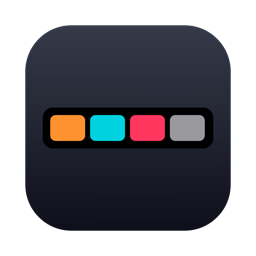
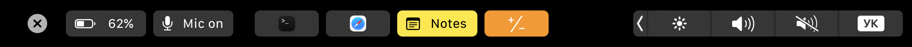
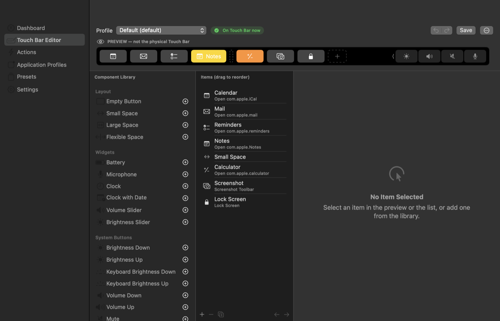
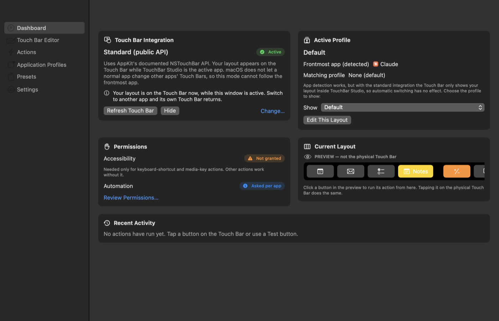
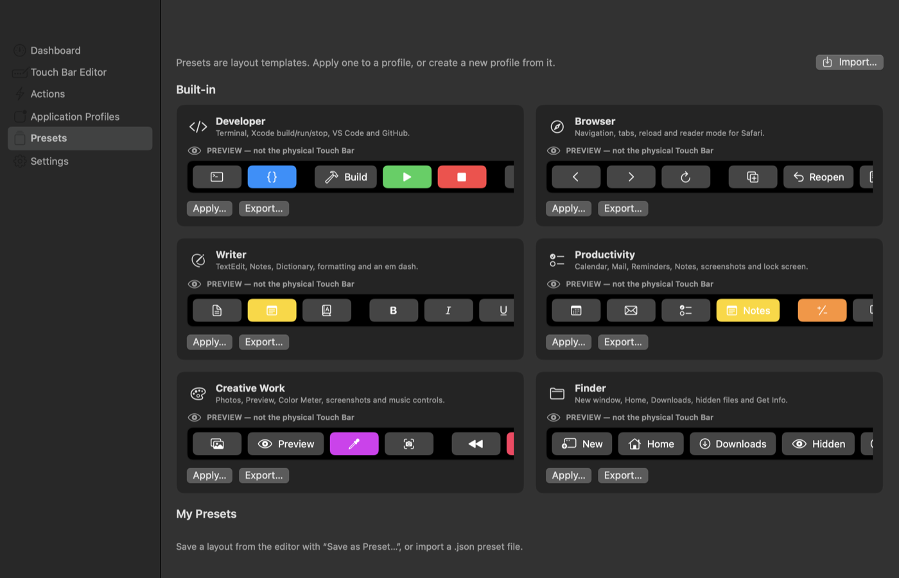
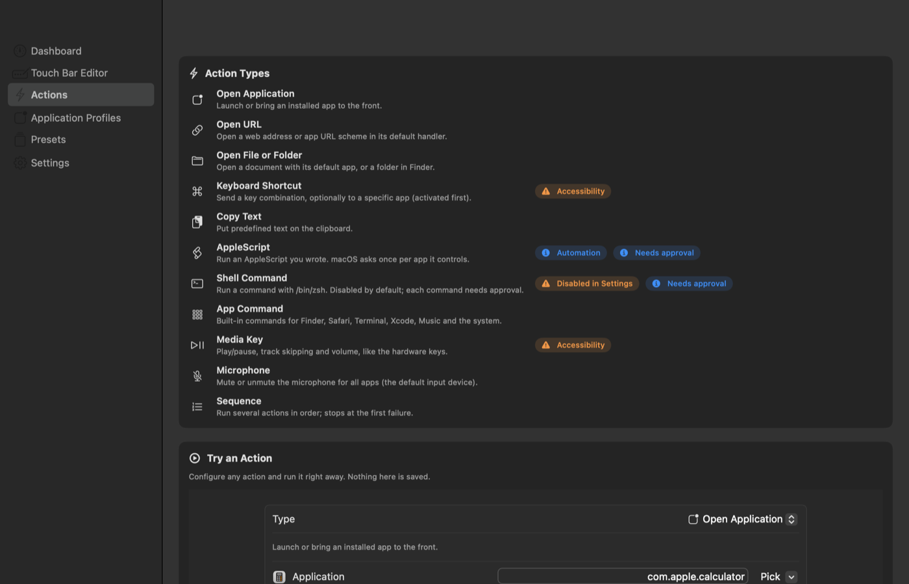
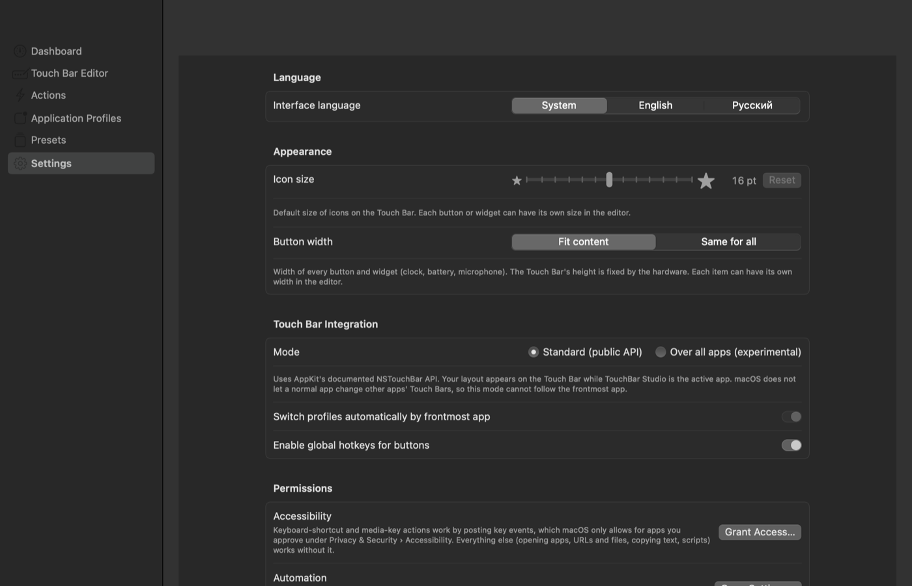

<div align="center">



# TouchBar Studio

**English** · [Русский](README.ru.md) · [Українська](README.uk.md)

**Make the Touch Bar on your MacBook Pro actually useful.**

Build your own buttons, put live widgets on the bar, switch layouts per app,
and share them as presets — in a native macOS app with no dependencies.

[](#requirements)
[](https://swift.org)
[](#install)
[](#interface-language)
[](LICENSE)

[**Download**](https://github.com/UkaUkaa/TouchBarStudio/releases/latest) ·
[Install guide](#install) ·
[Features](#features) ·
[FAQ & limitations](#limitations)

<br>



<sub>A real capture from the hardware (<code>screencapture -b</code>) on a 13" MacBook Pro M1 — not a mock-up.</sub>

<br><br>



</div>

---

## ✨ Highlights

<table>
<tr>
<td width="50%" valign="top">

### 🎛️ Your own buttons
Any title, SF Symbol, app icon or image, 11 colors, custom width and icon size.
Add a global hotkey to any button — no permissions required.

</td>
<td width="50%" valign="top">

### ⚡ Real actions
Open apps, URLs, files and folders, send keyboard shortcuts, copy text, run
AppleScript or shell commands, control media, or chain them into sequences.

</td>
</tr>
<tr>
<td valign="top">

### 📊 Live widgets
Battery with charge state, microphone mute for **every** app, a clock with any
format you like, volume and brightness sliders.

</td>
<td valign="top">

### 🔀 Per-app profiles
Finder gets its own bar, Safari its own, Terminal its own — switched
automatically as you change apps (in "Over all apps" mode).

</td>
</tr>
<tr>
<td valign="top">

### 🧩 Presets
Developer, Browser, Writer, Productivity, Creative Work and Finder out of the
box. Export your own as versioned JSON and share them.

</td>
<td valign="top">

### 🔒 Safe by default
Scripts need approval before their first run, shell is off until you enable it,
and imported presets are validated and shown in full before you accept them.

</td>
</tr>
</table>

## 📸 Screenshots

<table>
<tr>
<td width="50%"><p align="center"><b>Dashboard</b> — mode, active profile, permissions, activity log</p></td>
<td width="50%"><p align="center"><b>Presets</b> — one click to a ready-made layout</p></td>
</tr>
<tr>
<td><p align="center"><b>Actions</b> — every action type and what it needs</p></td>
<td><p align="center"><b>Settings</b> — language, appearance, integration mode</p></td>
</tr>
</table>

## 📑 Contents

- [Install](#install) · [First launch](#3-first-launch) · [Set up](#4-set-up) · [Update](#update) · [Uninstall](#uninstall)
- [How it reaches the Touch Bar](#how-it-reaches-the-touch-bar)
- [Features](#features)
- [Interface language](#interface-language)
- [Security and permissions](#security-and-permissions)
- [Limitations](#limitations)
- [For developers](#for-developers): [build](#build-test-install) · [architecture](#architecture) · [hardware verification](#verified-on-real-hardware)
- [License](#license)

---

## Install

> [!NOTE]
> You need a **MacBook Pro with a Touch Bar** (2016–2020, Intel or Apple silicon) running
> **macOS 14 Sonoma or later**. The app is universal.

### 1. Download

From the [latest release](https://github.com/UkaUkaa/TouchBarStudio/releases/latest), download
`TouchBarStudio-<version>.dmg` (recommended) or `TouchBarStudio-<version>.zip`.

<details>
<summary>Optional: verify the download</summary>

Put `SHA256SUMS.txt` in the same folder and run:

```sh
cd ~/Downloads
shasum -a 256 -c SHA256SUMS.txt --ignore-missing
```

Each downloaded file should be reported as `OK`.

</details>

### 2. Install

**From the DMG:** double-click `TouchBarStudio-<version>.dmg`, drag **TouchBar Studio**
onto the **Applications** folder in the window that opens, then eject the disk image
(the ⏏ button next to it in Finder).

**From the ZIP:** double-click the `.zip` to unpack it and move **TouchBar Studio.app**
into `/Applications`.

### 3. First launch

> [!IMPORTANT]
> The app is not notarized by Apple (it has an ad-hoc signature), so macOS blocks the
> first launch with a message that it can't verify the developer. You only need to allow
> it once.

1. Open **TouchBar Studio** from Applications. When the warning appears, click
   **Done** (or **OK**).
2. Open **System Settings › Privacy & Security**, scroll down to the **Security** section
   and click **Open Anyway** next to the message about TouchBar Studio.
3. Confirm with **Open Anyway** and your password or Touch ID.

On macOS 14 you can also Control-click the app in Finder, choose **Open**, then **Open**
again. Alternatively, in Terminal:

```sh
xattr -dr com.apple.quarantine "/Applications/TouchBar Studio.app"
```

After that the app opens normally.

### 4. Set up

| I want to… | Do this |
|---|---|
| See my layout right away | It's already there while TouchBar Studio is the active app |
| See my layout **in every app** | **Settings › Touch Bar Integration** → **Over all apps (experimental)** ([what this means](#how-it-reaches-the-touch-bar)) |
| Keep an app's own Touch Bar (e.g. Xcode or Final Cut Pro) | **Settings › Apps with Their Own Touch Bar** → **Add Application…**, or, while that app is in front, **Always Use <App>'s Own Touch Bar** in the menu bar |
| Start the app at login | **Settings › General › Launch at login** |
| Use keyboard-shortcut and media-key buttons | **Settings › Permissions** → **Grant Access…**, then turn on TouchBar Studio in System Settings. Everything else works without it |
| Switch to Russian or Ukrainian | **Settings › Language** |

### Update

Quit TouchBar Studio, then install the new version the same way, replacing the old app
in Applications. Your profiles and settings are kept.

> [!TIP]
> If keyboard shortcuts stop working after an update, turn TouchBar Studio off and on
> again in **System Settings › Privacy & Security › Accessibility**: the ad-hoc signature
> changes with every build.

### Uninstall

Quit TouchBar Studio (if your layout is shown over all apps, the normal Touch Bar comes
back when it quits), then delete the app and, if you don't want to keep your
configuration, its data folder:

```sh
rm -rf "/Applications/TouchBar Studio.app"
rm -rf ~/Library/Application\ Support/TouchBarStudio
```

Also remove TouchBar Studio from **System Settings › Privacy & Security › Accessibility**
if you granted access.

---

## How it reaches the Touch Bar

macOS gives a normal app control of the Touch Bar **only while that app is active**.
There is no public API for changing other apps' Touch Bars. TouchBar Studio therefore
has two interchangeable integrations behind the `TouchBarProvider` protocol:

| Mode | API | When your layout is visible | Per-app profiles |
|---|---|---|---|
| **Standard** (default) | Public `NSTouchBar`, attached to `NSApplication` | While TouchBar Studio is the active app | Detected, but can't be applied (the bar isn't shown in other apps) |
| **Over all apps (experimental)**, opt-in | Undocumented `+[NSTouchBar presentSystemModalTouchBar:placement:systemTrayItemIdentifier:]`, the API used by Pock and MTMR | Over every app | Applied automatically when the frontmost app changes |

The experimental mode is off by default and asks for confirmation before it turns on.
It is resolved at runtime with `class_getClassMethod`: if a future macOS release removes
the selector, the option is disabled instead of crashing. With "Keep the system Control
Strip" on (the default), macOS adds a close (✕) button and keeps brightness/volume.

**Closing the layout in one app (✕).** In experimental mode, tapping the system ✕ button
hides the layout in the app that is in front, so that app's own Touch Bar is shown. This
lasts only until another app comes to the front: the layout is shown there, and when you
return to the first app it is back as well (nothing is remembered). While still in that
app, the menu bar item "Show Layout in <App>" brings it back. The close is detected through
KVO on `NSTouchBar.visible`; on the test Mac holding fn did not change it, and events while
the display sleeps, the screen is locked or the login window is in front are ignored.

## Features

### Buttons and actions

- **Custom buttons**: title (shown or hidden), SF Symbol / app icon / image file, color,
  action, optional global hotkey (Carbon `RegisterEventHotKey`, no permission needed),
  optional associated app. Add, edit, duplicate, delete and reorder.
- **Actions** (`ActionRegistry` + `ActionExecutor`, all with real handlers):

  | Action | Notes |
  |---|---|
  | Open app · URL · file/folder | — |
  | Keyboard shortcut | Optionally sent to a specific app, which is brought to the front first. Needs Accessibility |
  | Copy text | — |
  | AppleScript | Needs approval; macOS asks for Automation once per target app |
  | Shell command | Off until enabled in Settings; needs approval |
  | App command | Built-in commands for Finder, Safari, Terminal, Xcode, Music and the system |
  | Media keys | Needs Accessibility |
  | Microphone | Toggle / mute / unmute for all apps |
  | Sequence | Runs steps in order, stops at the first failure |

  Failures are reported in the activity log and the Touch Bar button flashes red.

### Widgets

- **Battery**: live battery icon and percentage (IOKit power-source API, no permission
  needed). Updates on every power-source change, turns orange at 20% and red at 10% on
  battery power; tapping opens Battery settings (configurable or none).
- **Microphone**: mute/unmute the microphone for every app by setting the Core Audio mute
  property of the default input device (no permission needed; devices without a settable
  mute fall back to input volume 0 and back). The widget turns red while muted, follows
  changes made elsewhere and switches with the default input device.
- **Clock**: time, time with seconds, date and time, or date, in the interface language
  and following the macOS 12/24-hour setting — or a custom format: day/month or month/day
  or year first, year as YY/YYYY or none, date and time separators, seconds, 24/12 hours,
  weekday, time before or after the date (e.g. `26.10.26 14:05:09`, `10/26 2:05 PM`,
  `2026-10-26 14:05`), or your own Unicode date pattern. Tapping opens Calendar
  (configurable or none).
- **Volume and brightness sliders**: the volume of the default output device (Core Audio
  virtual main volume, no permission needed) and the brightness of the built-in display
  (the private DisplayServices framework, looked up at runtime). Both follow changes made
  with the keys, Control Center or auto-brightness.
- **System buttons**: brightness and keyboard backlight −/+, volume −/+, mute, previous /
  play-pause / next, and system commands (lock screen, screenshot, Spotlight, Mission
  Control…). Display brightness buttons change it directly and work without
  Accessibility; the others are sent like the hardware keys and need it.

### Layout and appearance

- **Layout editor**: a preview labelled "PREVIEW — not the physical Touch Bar" with a width
  estimate and overflow warning, a component library, a properties panel, drag and drop
  (library → bar, reordering within the bar and the list), undo/redo (⌘Z / ⇧⌘Z), revert,
  save and Save as Preset.
- **Icon size**: a default in Settings › Appearance (10–22 pt, standard 16) and an optional
  size per button or widget.
- **Button width**: every button and widget either fits its content or gets the same fixed
  width (30–300 pt); each item can instead have its own width, and volume/brightness
  sliders can have their own track width (60–400 pt). The height is fixed by the hardware.

### Profiles and presets

- **Application profiles**: create, rename, duplicate, delete, set default, associate apps,
  toggle automatic switching. Frontmost-app detection uses
  `NSWorkspace.didActivateApplicationNotification`.
- **Presets**: Developer, Browser, Writer, Productivity, Creative Work and Finder.
  Custom presets can be imported and exported as versioned JSON.
- **Apps with their own Touch Bar**: a list of apps in which your layout is never shown,
  so their native Touch Bar controls stay. Your layout is back as soon as another app is
  in front. Manage it in Settings, or toggle the app in front from the menu bar. Works in
  the "over all apps" mode; in the standard mode every app keeps its own Touch Bar anyway.

### Everywhere else

Dashboard, Actions, Application Profiles, Presets and Settings sections; a menu bar
extra; native menus (Layout, Touch Bar, ⌘1–⌘6 navigation); light and dark mode.

## Interface language

English, Russian and Ukrainian, switchable in **Settings › Language** (System / English /
Русский / Українська) without restarting. "System" follows the first preferred language in macOS.
Standard menus and panels supplied by macOS (Edit, Window, open/save dialogs) follow
`AppleLanguages` and switch after a restart; Settings offers a **Restart Now** button.

<details>
<summary>How translations work</summary>

Translations are Swift dictionaries in `Sources/TouchBarStudioCore/Localization/`, keyed
by the English text and accessed with `L("…")` / `Lp("%d items", n)` (Russian and
Ukrainian plural rules). There are no resource bundles, so the app behaves the same as a `.app`, under
`swift run` and in Xcode. `LocalizationTests` scans the sources and fails on a missing,
unused or placeholder-mismatched translation, and checks that the built-in presets fit
in Russian and Ukrainian too. Built-in preset names and button titles are localized when a profile is
created from them; buttons you've already created keep the titles you gave them.

</details>

## Security and permissions

| Permission | Needed for | When it's asked |
|---|---|---|
| **Accessibility** | Keyboard-shortcut and media-key actions only | Never at launch: Settings explains why, then you click **Grant Access…** |
| **Automation** | AppleScript that controls another app | By macOS, once per target app, on first use |
| *(none)* | Everything else: apps, URLs, files, text, widgets, hotkeys | — |

- **Shell commands** are disabled until enabled in Settings (with a warning). They run
  via `/bin/zsh -lc` with a timeout (default 30 s).
- **Script approval**: every AppleScript and shell command must be approved before its
  first run. Approval is keyed to a SHA-256 of the exact text and stored in
  `approved-scripts.json`, which is never exported. Editing a script revokes its
  approval. Imported presets never carry approvals, and the import sheet shows every
  script verbatim.
- **Import validation**: 512 KB size limit; `format` and `formatVersion` are checked;
  structure is decoded strictly; limits on item count, title and script length, and
  sequence depth/steps; `javascript:` URLs and unknown app commands are rejected.
  Imported items get new IDs.
- A configuration file that can't be read is moved aside (`config.unreadable-<date>.json`)
  instead of being overwritten.

Configuration lives in `~/Library/Application Support/TouchBarStudio/`.

## Limitations

- **Standard mode can't show your layout in other apps.** That's a macOS restriction, not
  something this app can work around with public API — use the experimental mode.
- **Experimental mode depends on an undocumented API** and may break in any macOS update.
- If TouchBar Studio quits while in experimental mode and is reopened in standard mode
  within a few seconds, macOS showed an empty Touch Bar for that whole session on the test
  Mac (reproduced 2/2; the next launch is fine). Switching modes inside a running app is
  not affected.
- In standard mode, a keyboard-shortcut button without a target app sends its keys to
  TouchBar Studio itself (the editor warns about this).
- Item widths in the preview are estimates calibrated against hardware captures of a 13"
  Touch Bar (icon-only button 72 pt, close button 60 pt, collapsed Control Strip 306 pt);
  macOS hides items that don't fit. A unit test checks that every built-in preset fits in
  the tightest layout (experimental mode with the Control Strip and close button).
- The brightness and keyboard-backlight media keys aren't offered: they can't be posted
  reliably on Apple-silicon Macs.
- App commands for apps that aren't installed (e.g. Xcode on the test machine) report
  "No installed application…" instead of pretending to succeed.

---

## For developers

Swift 6 · AppKit (`NSTouchBar`) for the Touch Bar · SwiftUI for the interface · no
third-party dependencies.

### Requirements

- macOS 14 Sonoma or later (developed and tested on macOS 27.0.1).
- A MacBook Pro with a Touch Bar to see results. On other Macs the app runs, but has
  no Touch Bar to drive.
- Swift 6 toolchain: the Xcode Command Line Tools are enough; full Xcode is optional.

### Build, test, install

```sh
scripts/build-app.sh            # release build → build/TouchBar Studio.app
scripts/build-app.sh debug      # debug build
scripts/test.sh                 # unit tests (Swift Testing)
open "build/TouchBar Studio.app"
cp -R "build/TouchBar Studio.app" /Applications/   # optional install
```

**Release:** `scripts/release.sh [version]` runs the tests, builds a universal
(arm64 + x86_64) app and writes `TouchBarStudio-<version>.dmg`, a `.zip` and
`SHA256SUMS.txt` to `dist/`. Passing a version updates `CFBundleShortVersionString` and
increments `CFBundleVersion` in `Support/Info.plist`. With a Developer ID set via
`SIGN_IDENTITY`, the DMG can then be notarized with `xcrun notarytool submit … --wait`
and `xcrun stapler staple`, which removes the Gatekeeper step above.

**Xcode:** open `Package.swift` (File › Open…) and run the `TouchBarStudio` scheme. No
`.xcodeproj` is included: this machine has only the Command Line Tools, so a generated
project file couldn't be built or verified. SwiftPM packages open natively in Xcode.
Note that running from Xcode or `swift run` launches a bare executable rather than the
`.app` bundle; Accessibility/Automation grants belong to the bundle, so test those with
`scripts/build-app.sh` and `open`.

Builds are **ad-hoc signed**. macOS ties Accessibility approval to the code signature,
so after rebuilding you may have to turn the permission off and on again for
TouchBar Studio. To sign with your own identity:
`SIGN_IDENTITY="Developer ID Application: …" scripts/build-app.sh`.

### Architecture

```
Sources/TouchBarStudioCore/   UI-independent, unit-tested
  Models/        ActionConfig, KeyCombo, TouchBarItemConfig, Profile, AppConfiguration, LayoutMetrics
  Actions/       ActionRegistry, ActionExecutor, SystemServices (protocol + live impl), ScriptTrustStore, AppCommandCatalog
  Storage/       ConfigurationStore (atomic JSON, corrupt-file backup, schema version)
  Presets/       Preset, PresetCodec (import/export/validation), BuiltInPresets
  Profiles/      ProfileResolver (which profile should be shown)
Sources/TouchBarStudio/       AppKit + SwiftUI app
  TouchBar/      TouchBarProvider (Application / SystemModal), TouchBarManager (NSTouchBar builder + tap routing)
  System/        ApplicationProfileManager (frontmost app), PermissionManager, HotKeyCenter, IconProvider
  Editor/        LayoutEditorViewModel (selection, mutations, undo/redo, component library)
  App/           AppModel (wiring + persistence), app/menus/menu bar extra
  Views/         Dashboard, Editor, Actions, Profiles, Presets, Settings, shared components
Tests/TouchBarStudioCoreTests/
```

Toolchain notes (Command Line Tools only):
- In the macOS 27 SDK, SwiftUI's `@State` is a macro whose plugin ships only with Xcode.
  The views use `@ViewState` (`Views/ViewState.swift`), a thin wrapper around the public
  `State<Value>` struct that compiles with either toolchain.
- `scripts/test.sh` passes the Swift Testing macro plugin path explicitly. Without it,
  SwiftBuild sometimes loses the plugin on incremental builds.

### Verified on real hardware

Test machine: MacBookPro17,1 (13" M1, 2020), macOS 27.0.1 (26A434), Swift 6.4 /
Command Line Tools. Touch Bar contents were captured from the hardware with
`screencapture -b`.

<details>
<summary>Show the full verification table</summary>

| Check | Result |
|---|---|
| Minimal proof app: custom button with icon and label appears on the physical Touch Bar | ✅ captured |
| Physical finger tap triggers the action (opened Calculator) | ✅ confirmed by the user and by Calculator's process start time |
| TouchBar Studio, standard mode: profile appears while the app is active | ✅ captured |
| Standard mode after the window is closed: reactivating the app reopens the window and the layout (without a key window macOS shows an empty bar) | ✅ captured |
| Experimental mode: layout shown while Finder / Safari / Terminal are frontmost | ✅ captured |
| Experimental mode: automatic switching (Finder → Finder profile, Safari → Safari profile, Terminal → default) | ✅ captured |
| Normal Touch Bar comes back when the app quits | ✅ captured |
| Full app, standard mode: physical tap on the Calculator button opens Calculator and is logged | ✅ confirmed by the user |
| Full app, experimental mode: in Finder, tapping "Downloads" opens the folder | ✅ confirmed by the user |
| Editor: drag-and-drop reorder, title edit, ⌘Z | ✅ confirmed by the user |
| Layout and mode persist after restarting the app (config unchanged, layout shown over Terminal) | ✅ captured |
| Battery widget shows the charging icon and the real percentage (98%) on the Touch Bar | ✅ captured |
| Microphone widget toggle (performed in-app exactly as a tap): Core Audio mute read back as 1 by a separate process, widget turns red; second toggle unmutes | ✅ captured + verified |
| Microphone widget follows a mute set by another process | ✅ captured |
| Physical finger tap on the microphone widget | Not separately tested (tap delivery itself is verified for buttons) |
| ✕ in Chrome shows Chrome's own Touch Bar; switching to Terminal shows the layout; back in Chrome the layout is shown again | ✅ user tapped ✕, rest captured |
| Holding fn does not count as closing (bar visibility unchanged, layout returns on release) | ✅ user test + trace |
| Keyboard-shortcut and media-key actions with Accessibility granted to the bundled app | ⚠️ Not verified on hardware (permission not granted during testing). Covered by unit tests with mocked services only. |
| AppleScript and shell actions from a Touch Bar tap | ⚠️ Shell runner verified by unit tests against real `/bin/zsh`; not tapped on hardware |

</details>

---

## License

[MIT with the Commons Clause](LICENSE). Copyright © 2026 Oleksandr Filinskyi.

> [!NOTE]
> **Free to use, not to sell.** Anyone, including companies, may use TouchBar Studio for
> free, including at work, and may copy, modify and share it. Selling it is not permitted:
> you may not offer it, or a product or service whose value comes entirely or
> substantially from it, for a fee (this includes paid hosting or paid support for it).
> Copies must keep the license text, including the Commons Clause notice. For other
> terms, contact the author.
